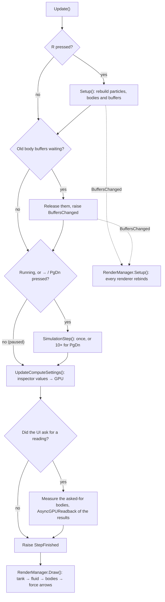
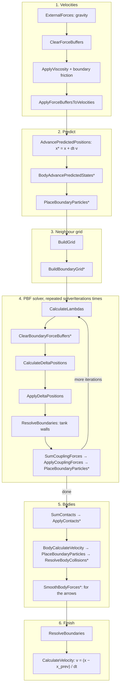
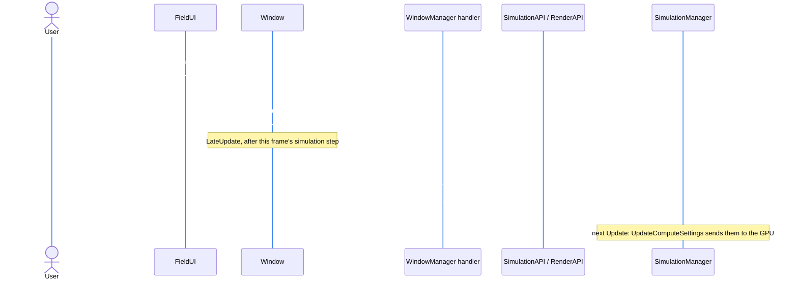
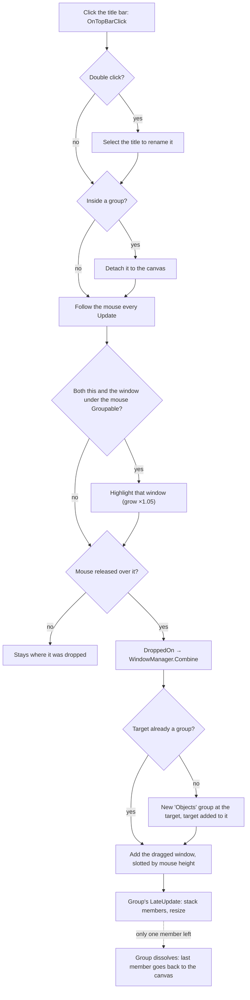

# Architecture

How a frame runs, what physics each step does, and why things are the way they are.

Code lives in [`Assets/3D/SimulationCode`](../Assets/3D/SimulationCode) (simulation), [`Assets/3D/RenderCode`](../Assets/3D/RenderCode) (drawing) and [`Assets/Interaction`](../Assets/Interaction) (windows, camera, menus). Everything physical runs on the GPU in [`Simulation.compute`](../Assets/3D/SimulationCode/Simulation.compute) and the files it includes. The C# side only orders the dispatches and moves settings across.

---

## 1. Frame flow

### Who does what

| Piece | Role |
|---|---|
| [`SimulationManager`](../Assets/3D/SimulationCode/SimulationManager.cs) | Owns every GPU buffer, dispatches the kernels each step, handles hotkeys and body edits |
| [`SimulationAPI`](../Assets/3D/SimulationCode/SimulationAPI.cs) | The UI's way in. Converts real units (m, kg, m/s², mPa·s) to sim units |
| [`RigidBodies3D`](../Assets/3D/SimulationCode/RigidBodies3D.cs) | CPU side of the bodies: samples surfaces, sets mass/inertia, builds body buffers |
| [`Spawn3DParticles`](../Assets/3D/SimulationCode/Spawn3DParticles.cs) | Initial fluid lattice, body surface samples, the tank size |
| [`SPValues3D`](../Assets/3D/SimulationCode/SPValues3D.cs) | The uniform grid used for neighbour search |
| [`RenderManager`](../Assets/3D/RenderCode/RenderManager.cs) | Listens to the simulation's events and drives every renderer |

The simulation and the renderers only talk through two events:

- **`BuffersChanged`**: raised by `Setup()` and after bodies are added/removed. Renderers rebind the buffers.
- **`StepFinished`**: raised once per frame, even when paused. Renderers draw.

`RenderManager` subscribes in `OnEnable`, which runs before `SimulationManager.Start`, so it never misses the first `BuffersChanged`.

### One frame (`SimulationManager.Update`)

Notes:

- **Body edits** (`AddBody`, `RemoveBody`, `ReshapeBody`) read the body states back from the GPU, rebuild the body buffers, and queue the old buffers. They are released at the start of the *next* frame, because this frame's draw calls may still be using them.
- **Readings** (scale weight, submerged percent) come back via async readback, so they lag a frame or two. They are only calculated for what the UI asked about that frame, and `WindowManager` doesn't ask about a field `Window.IsFieldVisible` says is hidden.
- **dt** is `1 / fakeFramerate` unless `useRealDeltaTime` is on. A fixed dt keeps the solver stable when the frame rate dips.

### One simulation step (`SimulationStep`)

Kernels marked `*` only run when there is at least one rigid body.

### The neighbour grid (`BuildGrid`)

The tank is split into cubic cells with edge length `interactionRadius` (h), so every neighbour of a particle is in its own cell or one of the 26 around it. Particles are sorted by cell with a counting sort:

1. **ClearGrid**: zero `CellStart`.
2. **CountParticles**: each particle atomically adds 1 to `CellStart[cell + 1]`.
3. **ScanStep** × `numScanSteps`: a Hillis–Steele prefix sum, ping-ponging between `CellStart` and `ScanTemp`. The pass count is rounded up to even so the result ends in `CellStart`.
4. **ResetCursor**: copy `CellStart` into `CellCursor`.
5. **Scatter**: each particle atomically takes the next slot in its cell and writes its index to `SortedIndices`.

A cell's particles are then `SortedIndices[CellStart[c] .. CellStart[c+1])`. The boundary particles use the same steps with their own `BoundaryCellStart` / `BoundarySortedIndices`. They share `ScanTemp` and `CellCursor`.

### GPU plumbing worth knowing

- **Every buffer is bound to every kernel** (`SetBuffers`). Buffer names in C# must match the names in `Simulation.compute`.
- **`…RO` buffers** are read-only aliases of the same `ComputeBuffer`. They exist because a kernel can bind only 8 read-write buffers. `ComputeHelper.LinkReadOnlyViews` points every name ending in `RO` at its buffer, so a new one only needs declaring in `Simulation.compute`.
- **`ComputeHelper`** does the buffer chores: `CreateBuffer` (never empty, zeroed or filled from data), `CreateDrawArgs` for indirect draws, `Read`/`ReadAsync`/`SetElement`, `SetBuffers` and `Release`, which releases a shared buffer once.
- **C# math** lives in `FluidMath3D.cs` and `RigidBodyMath3D.cs`, which mirror the `.hlsl` files of the same names: kernel factors, column weights, smoothing blends, shape volumes, inertias and signed distances.
- **Force accumulators** (`ForceBuffersX/Y/Z`, `BoundaryForceBuffersX/Y/Z`) are `int`, storing value × 10⁶. HLSL has no atomic float add, so atomics go through fixed point. A value above about ±2147 per step overflows, and anything below 10⁻⁶ is lost.
- **C#/HLSL structs must match byte for byte**: `RigidBodyProperties3D`/`RigidBodyState3D` in `RigidBodies3D.cs` mirror `RigidBodyProperties`/`RigidBodyState` in `RigidBodyMath3D.hlsl`. So do `MaxScales`, `ReductionThreads`, the slot sizes and the force order (also used by `Visualiser.cs`).
- **Rigid-body kernels** live in `RigidBodyKernels3D.hlsl`, but their `#pragma kernel` lines and buffers have to stay in `Simulation.compute`, because that's the only file `ComputeHelper` reads.

---

## 2. User interface

The UI never touches the simulation directly. Every window goes through **`SimulationAPI`** (physics, in real units) or **`RenderAPI`** (what's drawn).

### Who does what

| Piece | Role |
|---|---|
| [`WindowManager`](../Assets/Interaction/WindowManager.cs) | Opens each kind of window, wires its fields to the APIs, groups windows, drags scales, brings clicked windows to the front |
| [`Window`](../Assets/Interaction/Window.cs) | One draggable window: title bar, a list of `Field`s, minimise, close, grouping |
| `Field` (in `Window.cs`) | Plain data for one row: `Numeric`, `Dropdown`, `Toggle`, `Readout`, `Separator` or `Foldout` (shows or hides the `foldedFields` after it) |
| [`FieldUI`](../Assets/Interaction/FieldUI.cs) | The prefab that shows one `Field`: slider + input box, dropdown, or toggle |
| [`SimulationAPI`](../Assets/3D/SimulationCode/SimulationAPI.cs) / [`RenderAPI`](../Assets/3D/RenderCode/RenderAPI.cs) | The only things windows call |
| [`CameraController`](../Assets/Interaction/CameraController.cs) | Fly camera |
| [`ChangeScenes`](../Assets/Interaction/ChangeScenes.cs) | Menu buttons: `MainMenu`, `BuoyancyPractical`, `WavesPractical`, `SettingsScene` |
| [`SettingsScript`](../Assets/Interaction/SettingsScript.cs) / [`AppSettings`](../Assets/Interaction/AppSettings.cs) | Settings screen controls ↔ static app-wide settings |

The `WindowManager.Create…Window` methods and `OnSideMenuClick` / `OnSettingsClick` have no callers in code. They're hooked up to buttons in the scene through the Inspector's `OnClick` events.

### A window's data model

A window is just `List<Field> fields`:

1. `UpdateFields()` builds one `FieldUI` per field, stacked by `Field.GetHeight()`.
2. The handler in `WindowManager` refers to fields **by index**, hence constants like `Mass = 0, Volume = 1`. Reordering the field array means updating those constants.
3. Code can change what's shown with `SetField` / `SetToggle`. Those **don't** raise `FieldChanged`, so a handler can fix up other fields without triggering itself again.

### What happens when the user edits a field

Events are batched in `LateUpdate`, so dragging a slider fires one event per frame, not one per pixel, and the simulation never sees a half-applied change. Adding, removing or reshaping a body is the exception. It rebuilds the body buffers straight away (see *Frame flow*).

### Closing

`Close()` only sets a flag. In `LateUpdate` the window raises `Closed` and destroys itself. A group raises `Closed` for each member first. Handlers use `Closed` to clean up, e.g. an object window removes its body and a scale window removes its scale. **Closing a group removes every object in it.**

### Dragging and grouping

- A group is an ordinary `Window` whose background holds other windows instead of `FieldUI`s (`IsGroup`).
- Only object windows and groups are `Groupable`, so fluid, gravity, visualisation and scale windows can't be grouped.
- **Z-order is sibling order** on the canvas. `WindowManager` moves a clicked window to the last sibling, and `Window.TopmostAt` searches from the last sibling down. A minimised window's hit box is just its title bar.

### The windows

| Window | Fields | Does |
|---|---|---|
| **New object** | Mass (kg), Volume (L), Density (material dropdown), Shape, Measurements foldout holding Submerged percent (readout, %) and Displaced (readout, L) | Spawns a body as soon as it opens. Mass always follows from material × volume: editing Mass changes Volume to match (clamped), and editing Volume or the material changes Mass. Calls `SetBodyMass`, plus `SetBodyShape` when the size or shape changed. Closing removes the body. Renamable and groupable |
| **Fluid properties** | Density (kg/m³), Viscosity (mPa·s) | `SetDensity`, `SetViscosity` |
| **Gravity properties** | Gravity (m/s²) | `SetGravity` |
| **Visualisation** | A toggle per `BodyForce`, plus Values | `RenderAPI.DrawForce` / `DrawForceValues`. *Resultant* and the individual forces turn each other off |
| **Ruler N** | Length (readout, cm) | Puts a flat box in front of the camera, up to `Visualiser.MaxRulers`, marked every centimetre and numbered every 5, counted from its start end. It's only drawn, the simulation doesn't know about it. Right-dragging near an end moves that end with the other fixed, so it stretches or shrinks. Right-dragging the middle moves the whole ruler. Closing removes it |
| **Stopwatch** | Time (readout, s), Start/Stop and Reset buttons | Counts simulation time, so it stops while paused. Reset also stops it. Any number can be open |
| **Depth meter N** | Height (readout, cm), Height over time (graph, length set by `depthGraphSeconds`), Second ray | Adds a vertical red ray from the tank's floor to its top, which drags across the floor. Second ray adds a green one, drawn in the same graph, and each window owns two of the `DepthMeters.MaxMeters` rays. `DepthMeters` reads the particle positions back every 0.1 simulation seconds and turns the amount of fluid in a small column around the ray into a height, so it reads the volume-equivalent height. Closing removes the meter |
| **Wave generator** | On, Frequency (Hz of simulation time), Amplitude (cm) | Only one can be open. Opening adds the dipper, a full-width fixed box against the -x wall that lowers into the water. It's a `WaveDipper` component on the `SimulationManager` object, only in scenes with waves, and moves on `StepStarting` each simulation step, easing its amplitude at `easeSpeed`. The amplitude is capped so its acceleration stays under `maxAcceleration` × gravity, and it sits `clearance` + amplitude deep so its bottom stays under the water. Closing removes it |
| **Scale N** | Weight (readout, N), Show in world | Places a scale (up to `MaxScales`, the button does nothing past that). While the readout is visible, `UpdateScales` writes the reading to it and to the text on the scale each frame. Minimised, both keep the last value. Closing removes the scale |

**Moving scales and objects**: right-click one in the world and drag. It slides on a plane facing the camera. The scroll wheel moves that plane away from or towards the camera, `dragScrollStep` units per notch. A dragged object is held with its rotation kept, except that a cube pushed into a wall turns towards lying flat on it at `wallAlignSpeed`. On release it keeps the velocity it was dragged at, smoothed over `throwSmoothingTime` and capped at `maxThrowSpeed`, so it can be thrown. Scales stay where they're dropped.

**Settings card**: `OnSettingsClick` shows or hides it and pauses the simulation while it's open.

**Wave projection**: `ToggleWaveProjection` swaps everything drawn for the ripple tank view, while the simulation and windows keep running. `WaveProjectionRenderer` (optional on `RenderManager`, rendering only) builds a water height map by sharing particles between top-down grid columns (`cellsPerSpacing` per particle spacing), averages it over time, blurs it, and works out the light from its curvature: `1 / max(minFocus, 1 + screenDistance × (1 − 1/1.33) × ∇²h)`. The blur ignores the `edgeMargin` band next to the walls, where particles are sparse and the height dips, so the edges don't light up. The plane samples the light map with cubic B-spline filtering and shows `1 − exp(−exposure × light)`, with the exposure picked so still water shows `planeBrightness`, so bright bands roll off instead of clipping to white. Crests curve downwards and act as lenses, so they show as bright bands and troughs as dark ones, as in a real ripple tank. Absorption would give the opposite and be very faint.

### Controls

| Input | Effect | Handled in |
|---|---|---|
| Mouse, WASD, Q/E, Shift | Look, move, down/up, faster | `CameraController` |
| Esc | Toggle camera mode (cursor locked) / UI mode (cursor free). Clicking empty space in UI mode goes back to camera mode | `CameraController` |
| Right mouse (held) | Drag a scale, object, depth meter ray or ruler. Scroll while dragging to move it further (up) or closer (down) | `WindowManager` |
| Space / → / PgDn | Pause / step once / step 10× | `SimulationManager` |
| R | Rebuild the simulation | `SimulationManager` |

The `SimulationManager` hotkeys are ignored while a text field is focused.

### Settings screen

`SettingsScene` holds performance, theme, units and colour-blind filter controls. `SettingsScript` copies them into the static `AppSettings` fields. Those survive scene loads but aren't saved to disk. **Nothing reads `AppSettings` yet**, so the settings have no effect so far.

### Adding a new window

1. Add a public `CreateXWindow()` to `WindowManager`. Build its `Field[]`, open it with `CreateWindow(title, fields)` and subscribe to `FieldChanged` (and `Closed` if it owns something in the simulation).
2. If it needs something new from the simulation or renderers, add it to `SimulationAPI` / `RenderAPI` in real units. Don't call `SimulationManager` from the UI.
3. Hook a button's `OnClick` to the new method in the scene.

---

## 3. Physics

The fluid uses **Position Based Fluids** (PBF, Macklin & Müller 2013). Each step:

1. Apply forces to the velocities.
2. Predict positions.
3. Move particles until the density constraint holds.
4. Derive velocities from how far the particles actually moved.

Rigid bodies use **position-based rigid-body dynamics** and are coupled two-way to the fluid through **boundary particles** (Akinci et al. 2012).

### Symbols

| Symbol | Code | Meaning |
|---|---|---|
| $h$ | `interactionRadius` | Smoothing radius, also the grid cell size |
| $s$ | `spawn.Spacing` | Rest spacing between particles |
| $V = s^3$ | `particleVolume` | Volume each fluid particle stands for |
| $m = \rho_0 V$ | `particleMass` | Mass of a fluid particle. $\rho_0$ is `restDensity` |
| $\varepsilon$ | `relaxation` | Constraint softening (CFM) |
| $k$ | `artificialPressure` | Strength of the anti-clumping term |
| $\Delta t$ | `dt` | Time step |

### Smoothing kernels ([`FluidMath3D.hlsl`](../Assets/3D/SimulationCode/FluidMath3D.hlsl))

Density uses **Poly6**. The pushes use the gradient of **Spiky**, which doesn't vanish as $r \to 0$, so close particles still get pushed apart:

$$
W(r) = \frac{315}{64\pi h^9}\,(h^2 - r^2)^3
\qquad
\nabla W_{ij} = \frac{45}{\pi h^6}\,(h - r)^2\,\hat{\mathbf r}_{ij}
$$

for $r < h$, and zero otherwise. $\hat{\mathbf r}_{ij}$ is the unit vector from particle $i$ towards $j$. The constant factors are computed on the CPU (`poly6Factor`, `spikyGradFactor`) by `FluidMath3D.cs`.

### Density constraint

Density is **normalised**: it is a dimensionless packing fraction whose rest value is 1, not kg/m³. Three things add to it:

$$
\rho_i = \underbrace{\sum_j V\,W(r_{ij})}_{\text{fluid, including } i \text{ itself}}
\;+\; \underbrace{\sum_b V_b\,W(r_{ib})}_{\text{body surfaces}}
\;+\; \underbrace{\sum_{\text{axes}} \rho_{\text{wall}}(d)}_{\text{tank walls}}
$$

For the default $s = 3$, $h = 6$, a resting cubic lattice sums to $\rho \approx 1.01$, so the fluid settles at the spawn spacing. Changing the ratio $h/s$ shifts this, which is why `relaxation` needs retuning when `spacing` or `interactionRadius` changes.

The constraint is **one-sided**. It only resists compression, so stretched fluid (a splash or a free surface) is left alone instead of being pulled together:

$$
C_i = \max(\rho_i - 1,\; 0)
$$

`restDensity` ($\rho_0$) **does not affect the packing**. It only sets $m$, which matters for how hard the fluid pushes the bodies, i.e. buoyancy.

### The solver loop (one iteration)

**`CalculateLambdas`**: a Lagrange multiplier per particle, i.e. how hard it must push to fix its compression:

$$
\lambda_i = -\frac{C_i}{\Big\lVert \sum_j V \nabla W_{ij} + \text{body and wall terms} \Big\rVert^2 + \sum_j \lVert V \nabla W_{ij} \rVert^2 + \varepsilon}
$$

The first term is the gradient with respect to particle $i$. The second is the gradient with respect to each neighbour. $\varepsilon$ stops the division blowing up for isolated particles and softens the constraint. Below about 0.02 (at $s = 3$, $h = 6$) the solver overshoots and the fluid explodes.

**`CalculateDeltaPositions`**: each particle moves by

$$
\Delta\mathbf x_i = \sum_j V\,(\lambda_i + \lambda_j + s_{\text{corr}})\,\nabla W_{ij}
\;+\; \sum_b \lambda_i V_b \nabla W_{ib}
\;+\; \lambda_i\,\nabla\rho_{\text{wall}}
$$

$\lambda < 0$ under compression and $\nabla W_{ij}$ points towards the neighbour, so $\Delta\mathbf x_i$ points away from it.

$s_{\text{corr}}$ is the PBF paper's **artificial pressure**. It adds a small repulsion that keeps particles from clumping at the surface:

$$
s_{\text{corr}} = -k \left(\frac{W(r_{ij})}{W(0.2h)}\right)^4
$$

Because the constraint is one-sided, nothing holds the free surface together, so **`ApplyViscosity`** also adds Akinci et al. (2013) cohesion between fluid particles. $C$ attracts, but turns repulsive below about $0.28h$, so it can't cause the clumping (tensile instability) that unclamping the constraint would. The factor $2/(\rho_i + \rho_j)$, capped at 2, makes it act mostly on the under-dense surface. $\gamma$ is `cohesion`:

$$
\Delta\mathbf v_i = \Delta t\,\gamma \sum_j V\,\frac{2}{\rho_i + \rho_j}\,C(r_{ij})\,\hat{\mathbf r}_{ij}
\qquad
C(r) = \frac{32}{\pi h^9}\begin{cases} 2(h-r)^3r^3 - \frac{h^6}{64} & r \le \frac h2 \\ (h-r)^3r^3 & \frac h2 < r \le h \end{cases}
$$

It's fluid to fluid only, so it never pulls on the bodies.

**`ApplyDeltaPositions`** then **`ResolveBoundaries`**: apply the moves, then clamp any particle that went past a wall back inside. `collisionDamping` is the distance it's placed inside the wall. Despite the name it's a distance, not a damping factor.

More iterations means less compression in deep fluid. Fluid at the bottom is squeezed hardest, because the corrections take several iterations to travel up the column.

### Tank walls

Particles near a wall have no fluid on that side, so their density would be too low and they'd clump against the wall. To fix this, each wall adds the density a continuous fluid beyond it *would* contribute. That is the integral of Poly6 over the half-space past the wall, per axis, with $x = \text{clamp}(d/h, 0, 1)$ and $d$ the distance to the wall:

$$
\rho_{\text{wall}}(x) = \frac12 - \frac{315}{256}\left(x - \frac43 x^3 + \frac65 x^5 - \frac47 x^7 + \frac19 x^9\right)
\qquad
\frac{\partial \rho_{\text{wall}}}{\partial d} = \frac{315}{256\,h}\,(1 - x^2)^4
$$

It is 0.5 at the wall and 0 at one radius away. The gradient pushes the particle away from the wall through $\lambda_i$, the same way a neighbour would. `ResolveBoundaries` is only a backstop.

### Viscosity (`ApplyViscosity`)

Runs on the velocities before prediction. For each pair of particles closing in on each other (inward speed $u = (\mathbf v_i - \mathbf v_j)\cdot\hat{\mathbf r}_{ij} > 0$), an impulse evens out their speeds:

$$
\mathbf I_{ij} = \tfrac12\,\Delta t\,(1 - q)\,(\sigma + \beta)\,u\,\hat{\mathbf r}_{ij},
\qquad q = r_{ij}/h
$$

$i$ gets $-\mathbf I$ and $j$ gets $+\mathbf I$, accumulated atomically. $\sigma$ is `highViscosity` and $\beta$ is `lowViscosity`. This is the linear term of Clavet et al. (2005).

> **Note:** in Clavet's original the second coefficient multiplies $u^2$. Here both multiply $u$, so the two settings act as one coefficient $\sigma + \beta$. The UI's "viscosity" control sets `lowViscosity`.

**Boundary friction** uses the same formula with $\sigma$ = `boundaryFriction`, between fluid particles and boundary particles. It only slows the fluid, and it keeps fluid from tunnelling into fast bodies.

### Rigid bodies

Each body is a cube, sphere or scale with:

- a centre-of-mass state: position, quaternion, their previous values, linear and angular velocity
- a set of **boundary particles** sampled on its surface, stored relative to the body and moved with it by `PlaceBoundaryParticles`

| Shape | Inverse mass | Inertia |
|---|---|---|
| Cube (half-size $r$) | $1/M$ | $I = M(2r)^2/6$ |
| Sphere (radius $r$) | $1/M$ | $I = \tfrac25 M r^2$ |
| Scale | 0 (static, only the CPU moves it) | ∞ |

**Boundary particle volume** (`CalculateBoundaryVolumes`, run once when bodies are built): a boundary particle stands in for as much fluid as the gaps between its neighbours on the same body, so a densely sampled patch doesn't count as extra-dense wall:

$$
V_b = \frac{1}{\sum_{k \in \text{same body}} W(r_{bk})}
$$

**Fluid → body (buoyancy and drag)**: inside the solver loop, every push a fluid particle gets from boundary particle $b$ is recorded on $b$ with the opposite sign: $-\lambda_i V_b \nabla W_{ib}$. Per body (`SumCouplingForces`, 64 threads per body):

$$
\mathbf F = m \sum_b \mathbf f_b
\qquad
\boldsymbol\tau = m \sum_b (\mathbf x_b - \mathbf x_{cm}) \times \mathbf f_b
$$

These are position-level impulses (mass × displacement). `ApplyCouplingForces` moves the body by $M^{-1}\mathbf F$ and rotates it by $I^{-1}_{\text{world}}\boldsymbol\tau$, clamped to 0.2 rad per iteration. The buoyancy arrow shows $\mathbf F/\Delta t^2$. Fluid and body are solved one after the other, not together, so very light bodies can jitter.

**Contacts** (`SumContacts` → `ApplyContacts`, once per step after the solver): each boundary particle is checked against

- the tank walls, inset by $s$ so fluid still fits under a resting body
- every other body, via its signed distance function

For a contact with penetration $d$, normal $\mathbf n$ and lever arm $\mathbf r$ from the centre of mass, using the generalised inverse mass

$$
w = M^{-1} + (\mathbf r\times\mathbf n)^\top I^{-1}_{\text{world}}(\mathbf r\times\mathbf n),
$$

the normal correction is $\lambda_n = d/w$. Friction is Coulomb friction at position level: the tangential slip $\Delta\mathbf x_t$ is undone up to the friction cone,

$$
\lambda_t = \min\!\left(\frac{\lVert\Delta\mathbf x_t\rVert}{w_t},\; \mu\,\lambda_n\right),
\qquad \mu = \texttt{bodyFriction}
$$

Contacts are grouped (x-walls, y-walls, z-walls, other bodies, each scale). Within each group the corrections are averaged, so a face resting on the floor counts as one contact, not hundreds. The approaching part of the motion is also removed from `prevPosition`, so the velocity derived next has no component into the surface. Contacts are fully inelastic.

**Velocities** (`BodyCalculateVelocity`), from how far the body moved:

$$
\mathbf v = \frac{\mathbf x - \mathbf x_{\text{prev}}}{\Delta t}
\qquad
\boldsymbol\omega = \frac{2\,\text{vec}(q\,q_{\text{prev}}^{*})}{\Delta t}
$$

with the sign flipped if needed to take the shorter way round.

**`ResolveBodyCollisions`** is the fluid-side backstop. Any fluid particle closer than `particleRadius` to a body's surface (by signed distance) is pushed out along the normal.

### Scales

A scale is a static body: a box base plus a cylindrical pan. In `ApplyContacts`, each moving body records how hard its scale contact group pushed on it:

$$
\mathbf F_{\text{scale}} = \frac{\Delta\mathbf x_{\text{friction}} - \Delta\mathbf x_{\text{approach}}}{M^{-1}\,\Delta t^2}
$$

`ScaleForce` sums the y-components over every body, and `SimulationAPI` converts that to newtons. Under water this reads **weight − buoyancy**.

### Submerged percent

`MeasureSubmergedBody` runs once per body whose readout is visible and marks the surface particles with fluid within `wetDistance` particle spacings. `RigidBodies3D.SubmergedFraction` picks the waterline height that the most particles agree with (wet below, dry above), so fluid resting on top of a body doesn't raise it, then works out the sphere's or cube's volume below it. It looks at the geometry only, so it doesn't depend on the buoyancy force. It assumes one flat waterline per body.

### Units ([`SimulationAPI`](../Assets/3D/SimulationCode/SimulationAPI.cs))

The solver works in sim units. The API converts at the boundary:

| Quantity | Scale | Default |
|---|---|---|
| Length | `lengthScale` sim units per m | 200 |
| Density | `densityScale` restDensity per kg/m³ | 1/1000 |
| Gravity | `gravityScale` sim gravity per m/s² | 20 / 9.81 |
| Viscosity | `viscosityScale` lowViscosity per mPa·s | 1 |
| Mass | `densityScale · lengthScale³` per kg | derived |
| Force | mass scale · gravity scale per N | derived |

These were picked by eye to look like water on Earth, not measured.

### Inspector parameters

| Setting | Effect |
|---|---|
| `interactionRadius` | $h$. Larger means smoother and more neighbours, but slower. Also the grid cell size |
| `gravity` | Sim gravity, negative is down |
| `solverIterations` | PBF iterations per step. More means less compression at depth |
| `relaxation` | $\varepsilon$. Too low explodes, too high is springy |
| `artificialPressure` | $k$ in $s_{\text{corr}}$. 0.1 in the paper |
| `cohesion` | $\gamma$. Pulls the surface together. 0 is off, too high pulls splashes into round droplets |
| `restDensity` | Particle mass only. Sets buoyancy, not packing |
| `highViscosity`, `lowViscosity` | Summed viscosity coefficient (see note above) |
| `boundaryFriction` | Fluid drag at body surfaces. ≤ 0 lets fluid tunnel |
| `bodyFriction` | Coulomb μ between bodies, and against walls and scales |
| `collisionDamping` | Inset distance after a wall clamp |

### Known approximations

- **Viscosity uses the previous step's grid**: it runs before `BuildGrid`. Neighbours that crossed a cell boundary since then can be missed for one step.
- **Fixed-point atomics** cap per-step force accumulation at about ±2147 and round off below 10⁻⁶.
- **Sequential fluid/body coupling**: light bodies can jitter.
- **`relaxation` depends on the scene**: the safe value depends on $h/s$.

### References

- M. Macklin, M. Müller. *Position Based Fluids*. ACM TOG (SIGGRAPH) 2013.
- N. Akinci et al. *Versatile Rigid-Fluid Coupling for Incompressible SPH*. ACM TOG (SIGGRAPH) 2012.
- S. Clavet, P. Beaudoin, P. Poulin. *Particle-based Viscoelastic Fluid Simulation*. SCA 2005.
- M. Müller et al. *Position Based Dynamics*. JVCIR 2007.
- M. Müller et al. *Detailed Rigid Body Simulation with Extended Position Based Dynamics*. SCA 2020.

---

## 4. Decision log

Newest at the top. One row per decision: what was chosen, what it replaced, and why. Features from the requirements are not skipped.

| Date | Decision | Why | Alternatives considered |
|---|---|---|---|
| 2026-11-04 | Switched the fluid from Clavet double-density relaxation to PBF | SPH coudldn't simulate buoyancy as it only considered immediate neighbours | Keep Clavet and leave a small gap under the bodies |

<!--
Example row:
| 2026-11-04 | Switched the fluid from Clavet double-density relaxation to PBF | ... | Keep Clavet and ... |
-->
